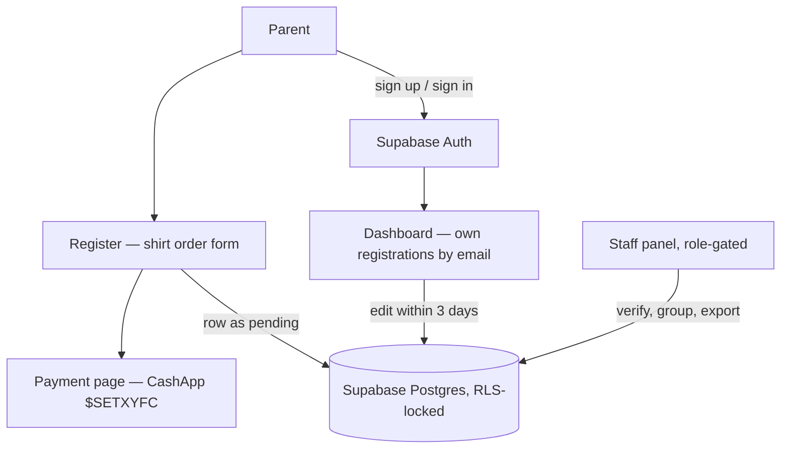

<p align="center">
  
</p>

<h1 align="center">SETX Football</h1>

<p align="center">
  <b>Registration and shirt-order management for SETX Football Camp.</b>
</p>
<p align="center">
  A youth football camp in Southeast Texas — parents sign up and pay by CashApp,<br />
  staff verify and manage the roster. Live at <a href="https://www.setxfootball.org">www.setxfootball.org</a>.
</p>
<p align="center">
  <sub>Published for reading. Proprietary — see <a href="LICENSE.md">LICENSE.md</a>. Outside contributions are not accepted.</sub>
</p>

<p align="center">
  
  
  
  
  
  
  
</p>

<br />

## Why SETX Football

Camp registration has to be effortless for a parent on a phone and airtight for the volunteers running check-in. This is the whole camp online: a public marketing site, a registration and shirt-order flow that takes payment over CashApp without forcing an account, and a role-gated staff panel that verifies each payment and works the roster — all on Supabase with row-level security, so parents only ever see their own registrations.

<table width="100%">
  <tr>
    <td width="33%" valign="top">
      <h3 align="center">Register &amp; pay</h3>
      <p align="center">A multi-shirt order form with a live $5-per-shirt total, then CashApp payment to <code>$SETXYFC</code> — no account required to start.</p>
    </td>
    <td width="33%" valign="top">
      <h3 align="center">Parent dashboard</h3>
      <p align="center">Signed-in parents track payment status and edit their registration inside a 3-day window with a live days-remaining countdown.</p>
    </td>
    <td width="33%" valign="top">
      <h3 align="center">Staff panel</h3>
      <p align="center">A role-gated roster with search, family grouping, revenue KPIs, one-toggle payment verification, and CSV export.</p>
    </td>
  </tr>
</table>

<br />

## Stack

| Layer       | Technology                                                                                |
| :---------- | :---------------------------------------------------------------------------------------- |
| UI          | React 19 + React Router 7                                                                 |
| Build & dev | Create React App (`react-scripts` 5)                                                      |
| Styling     | Tailwind CSS 3.4 + the vendored `@bradley-t-t/sunday-design-system` preset                |
| UI & SEO    | `framer-motion` · `lucide-react` · `react-helmet-async`                                   |
| Backend     | Supabase — Postgres, Auth, Row-Level Security                                             |
| Data access | `AuthService` + `RegistrationService`, returning `{ data, error }` tuples                 |
| Analytics   | First-party, cookieless beacon (`src/library/sunday-analyzer`)                            |
| Site chrome | `@taylorurl/split-rail` — the shared footer bar, pinned to a release tag                  |
| Delivery    | Static build, one prerendered document per public route, served by Vercel (`vercel.json`) |

The design system ships as a committed tarball under `vendor/` and is referenced from `package.json` as `file:./vendor/…tgz`, so installs and CI builds resolve it without a registry. Its peers — Radix, `framer-motion`, `lucide-react`, `recharts`, `clsx`, `tailwind-merge`, `class-variance-authority` — are declared here to satisfy it, so a few appear in `package.json` without appearing in `src/`.

## Getting started

```bash
npm install           # design system from vendor/, everything else from npm and GitHub
npm start             # dev server at localhost:3000
npm run build         # production build to build/
npm run lint          # ESLint, which the build does not run
```

The design system resolves from the committed tarball, but the install still needs a network: the rest of the tree comes from npm, and `@taylorurl/split-rail` from GitHub.

Copy `.env.example` to `.env` and fill in the Supabase credentials. The client is loaded on the first query rather than at boot, so a missing value surfaces the moment somebody signs in, signs up, or files a registration — the marketing pages render either way:

| Variable                      | Purpose                                          |
| :---------------------------- | :----------------------------------------------- |
| `REACT_APP_SUPABASE_URL`      | Supabase project URL.                            |
| `REACT_APP_SUPABASE_ANON_KEY` | Supabase publishable key for the browser client. |

`start`, `build` and `test` all run with `DISABLE_ESLINT_PLUGIN=true`, so a lint warning cannot fail a build. Linting is its own command, and CI runs `format:check`, `lint`, `test` and `build` in that order on every pull request.

### Scripts

| Script                 | Does                                                |
| :--------------------- | :-------------------------------------------------- |
| `npm start`            | Start the CRA dev server.                           |
| `npm run build`        | Production build to `build/`.                       |
| `npm test`             | Jest via `react-scripts`, `--passWithNoTests`.      |
| `npm run images:avif`  | Re-encode the AVIF photo derivatives; needs ffmpeg. |
| `npm run lint`         | Lint with ESLint.                                   |
| `npm run format`       | Rewrite the tree to the Prettier config.            |
| `npm run format:check` | Report formatting without writing; CI runs it.      |
| `npm run eject`        | One-way CRA eject.                                  |

`postbuild` runs after every build, in order:

| Step                                 | Does                                                                                                                                                                                 |
| :----------------------------------- | :----------------------------------------------------------------------------------------------------------------------------------------------------------------------------------- |
| `scripts/drop-remote-font-import.js` | Strip the design system's `@import` of Google's font host out of the built stylesheet; the faces are served from this origin and preloaded in `public/index.html`.                   |
| `scripts/preload-hero-image.js`      | Add a `preload` for the photograph the first screen draws, resolved from the `Photo` the source marks `priority`.                                                                    |
| `scripts/preload-shared-chunks.js`   | Add a `preload` for the chunk the lazy routes have in common.                                                                                                                        |
| `scripts/start-bundle-after-hero.js` | Move the bundle's script tag out of the head and start it one frame after the hero image settles.                                                                                    |
| `scripts/prerender.js`               | Write each public route's first screen into a document of its own; `/auth`, `/dashboard`, `/staff` and `/payment` are left as the empty shell, and the catch-all becomes `404.html`. |

## Routes

| Path                              | Page                       | Access        |
| :-------------------------------- | :------------------------- | :------------ |
| `/`                               | Home                       | Public        |
| `/about`                          | About                      | Public        |
| `/gallery`                        | Gallery                    | Public        |
| `/sponsors`                       | Sponsors                   | Public        |
| `/register`                       | Register                   | Public        |
| `/payment`                        | Payment instructions       | Public        |
| `/auth`                           | Sign in / sign up          | Public        |
| `/dashboard`                      | Parent dashboard           | Signed in     |
| `/staff`                          | Staff panel                | Staff / admin |
| `/contact`                        | Contact                    | Public        |
| `/privacy` · `/terms` · `/design` | Legal and design reference | Public        |
| `*`                               | Not found                  | Public        |

## Architecture



## How it works

- **No component touches Supabase directly.** Every read and write flows through `AuthService` and `RegistrationService`, which return `{ data, error }` tuples; `library/supabaseClient.js` is the single client.
- **Registration lands as `pending`.** The form writes a row to `camp_registrations` and forwards to the payment page with CashApp instructions for the `$SETXYFC` handle.
- **Accounts reconcile by email.** Creating an account (with email verification) lets a parent return to a dashboard that finds their registrations by `parent_email` and exposes an inline edit form for `EDIT_WINDOW_DAYS` (3) after creation.
- **Staff work the same table.** The panel filters by camp year and payment status, groups family registrations, surfaces live revenue KPIs, flips payment `pending` ↔ `paid`, and exports filtered rows to CSV.
- **Roles live in `user_profiles`.** `AuthContext` exposes the user, profile, and `isStaff` / `isAdmin` flags; `ProtectedRoute` gates `/dashboard` and `/staff`.

### Security

- **Row-Level Security** — the policies in `supabase/migrations/` scope `camp_registrations` and `user_profiles` to their owner, recognised either by `user_id` or by the verified email on the session matching `parent_email`, with staff and admin covered by `is_camp_staff()` reading `user_profiles.role`.
- **Least privilege** — `anon` holds `insert` on `camp_registrations` and nothing more; everything else is a signed-in grant, and `user_profiles` is closed to `anon` entirely. A parent filing without an account reads nothing back, so the client mints the row id rather than depending on a returning clause.
- **Service boundary** — only the two services import the Supabase client. A query names the row and nothing else: which rows an account may touch is the policy's answer, not a predicate the browser can drop.
- **No credential fallbacks** — Supabase config comes only from env vars, and CSV export escapes formula triggers to prevent injection.

## Project structure

```
setxfootball-com/
├── api/                   version.js — the commit this deployment was built from
├── public/                index.html, sitemap, manifest, favicons, fonts,
│                          robots.txt, llms.txt, release.json, sponsors/
├── scripts/               the postbuild chain, and the AVIF re-encoder
├── supabase/migrations/   row-level security, grants, policy revisions
├── vendor/                bradley-t-t-sunday-design-system-*.tgz (committed)
└── src/
    ├── app/               App.jsx — the route table; Root.jsx — everything
    │                      above the router, mounted by the browser and the
    │                      prerender alike
    ├── pages/             Home, About, Gallery, Sponsors, Register, Auth,
    │                      Dashboard, StaffPanel, Payment, Contact, Privacy,
    │                      Terms, Design, NotFound
    ├── components/        nav, footer, marketing sections, routing, seo, brand,
    │                      layout, ui, reactbits
    ├── context/           AuthContext.jsx — session state + role flags
    ├── services/          AuthService.js, RegistrationService.js — Supabase access
    ├── hooks/             useStaffRegistrations, useAdaptiveNavSurface,
    │                      useScrollReveal, useCountUp, …
    ├── utils/             constants, helpers, csv, shirtOrders, registrationGrouping
    ├── library/           supabaseClient.js, sunday-analyzer/
    ├── content/           campContent.js, terms.js
    └── assets/            the logo at two widths in PNG and WebP, images/
```

## License

Copyright (c) 2026 TaylorURL LLC. All rights reserved. See [LICENSE.md](LICENSE.md).

<br />

<p align="center">
  <sub>Sign up, pay, and hit the field — SETX Football Camp.</sub>
</p>
